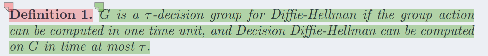
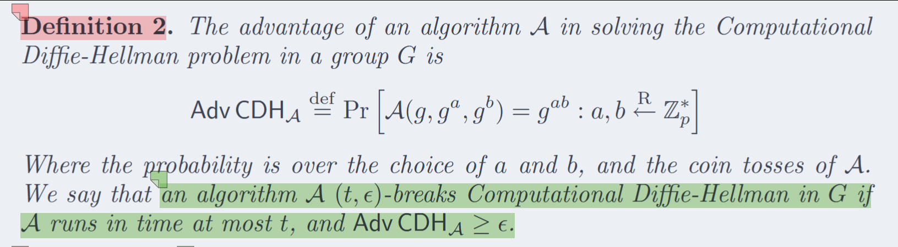
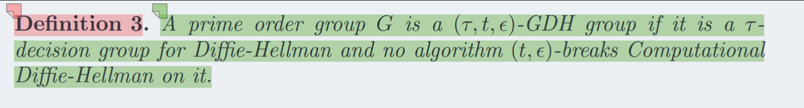
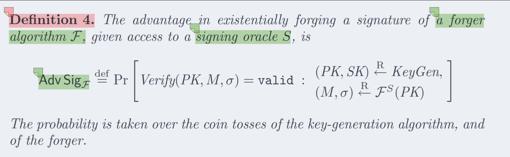
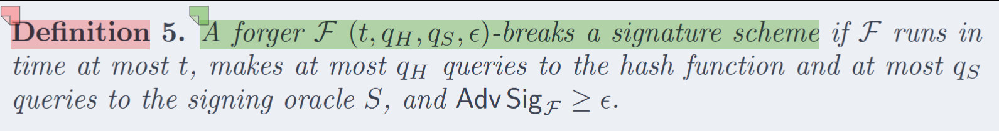
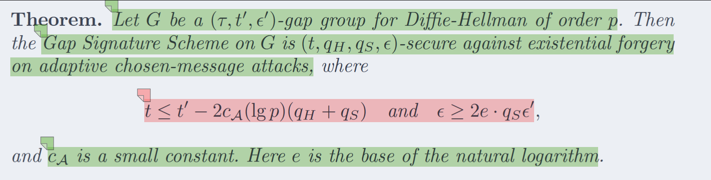

# <a href="zotero://open/library/items/B4CVZ9EA?page=1">“1 Introduction”</a> (<a href="zotero://select/library/items/RDIHF69V">Boneh 等, p. 516</a>)

### 背景

这里是简单介绍了全文的背景为什么需要这个内容

1.  如果人类要手工输入签名，那么就需要短签名的产生
2.  如果我们的信道是低带宽，那么我们也需要短签名来传输

但是当时的环境下 RSA和DSA都提供了长签名

虽然有人探讨过 使用  变体椭圆曲线的ECDSA 也需要320bits长度，人类手工输入320bits还是太长了

### 作者的签名方案

BLS签名方案长度是DSA的一半也就是 160bits，但是安全性程度和320bits的DSA一样

主要抵抗的选择明文攻击的存在性伪造攻击\
只要基于特征3的有限域上的椭圆曲线的CDH是困难的【无法解决】那么我们的签名方案就是安全的

通过标量乘法产生签名，通过双线性配对进行验证【这些都会在后面提到】

下面是基于本论文椭圆曲线产生的不同长度的签名方案【还不可以产生任意长度】

### 别人对短签名的尝试

前人有尝试缩短DSA的签名长度，但是依旧保持相同的安全

通过消息恢复的方法缩短DSA的签名长度\
通过一次编码一部分，从而让全体都缩短

如果对于长消息 那么确实可以做到缩短为160bits\
但是对于短消息，那么可能会反而导致扩展到 320bits

我们的签名方案是不约束消息的，都会生成长度为 160bits的签名

### 原理简述

这里签名方案是基于一个群——CHD计算困难，但是DDH判断简单

我们把满足上面的群叫做Gap DH群 或者叫做短GDH群

虽然之前有人基于GDH群产生签名方案，但是都是产生长签名方案，而不是短签名方案

# <a href="zotero://open/library/items/B4CVZ9EA?page=2">“2 Signature schemes based on Gap-Diffie-Hellman”</a> (<a href="zotero://select/library/items/RDIHF69V">Boneh 等, p. 517</a>)

这里说明了签名方案 他是基于GDH群构建的

## <a href="zotero://open/library/items/B4CVZ9EA?page=3">“Gap Diffie-Hellman Groups (GDH groups)”</a> (<a href="zotero://select/library/items/RDIHF69V">Boneh 等, p. 518</a>)

这里就介绍了 GDH群是什么

下面先引入一个群G 还有一些内容

1.  一个乘法群G 是一个循环群\<g>，并且阶数是素数p——素数乘法循环群
2.  群运算是乘法：u,v in G find uv
3.  DDH问题：a,b,c in Z\*p 给定(g,g^a,g^b,g^c)，要求判断c?=ab
4.  CDH问题：a,b in Z\*p 给定(g,g^a,g^b)，要求计算出g^ab

上面就是介绍了CDH DDH 还有这个群G的基本信息 下面开始正式定义出GDH群

定义1：G是一个t-DDH群 如果对于群运算可以在一个单位时间内执行，并且DDH可以被在t时间内计算完毕

【下面定义出攻击者】

定义2：窃听者A尝试去解决CDH难题在G上并且概率定义如下：

如果攻击概率超过投硬币正反概率，那么我们认为A是一个在G上(t,c)攻破CDH难题的算法，其中t是最多运行时间，c是最低攻破概率

定义3：一个素数群G如果不存在任何(t,c)攻破CDH算法的存在，那么就是一个(t,T,c)的GDH群

【基于DDH简单，CDH困难 从而定义出GDH群】

到此位置我们已经知道了 GDH群就是CDH难 但是DDH简单的群

## <a href="zotero://open/library/items/B4CVZ9EA?page=3">“2.2 The GDH Signature Scheme The GDH Signature Scheme allows the cr”</a> (<a href="zotero://select/library/items/RDIHF69V">Boneh 等, p. 518</a>)

我们知道了GDH 那么开始基于GDH构建签名算法

【现在讨论的都是基于GDH群，还没有到椭圆曲线问题】

先了解一下GDH签名方案的IO和系统参数

输入：是允许任意长度的M

输出：签名o，并且这个签名是G中元素

系统参数：基本群G和生成元g

我们定义 G\* 是G排除1的集合

一个正常的签名方案存在三个程序，但是BLS还存在一个全域哈希函数h，目标是把输入的消息M映射到G*上，这里我们先认为他是 随机预言机，后续会具体说是什么和如何构建的

**Key Generation：**&#x4EA7;生私钥和公钥的，从完全剩余中随机选择x in Z\*p，由私钥计算公钥v = g^x

**Signing：**&#x4F7F;用私钥x和消息M，先使用随机预言机计算 h = h(M) 得到哈希结果，然后计算签名 o=h^x 这个签名o in G\*

**Verification：**&#x7ED9;定公钥v M 和o 先使用哈希计算 h 然后验证 (g,v,h,o)是否是一个合法的DDH群

因为签名o是G\*上的元素 所以要求元素也是短的 这样才可以实现短签名

## <a href="zotero://open/library/items/B4CVZ9EA?page=4">“2.3 Security”</a> (<a href="zotero://select/library/items/RDIHF69V">Boneh 等, p. 519</a>)

分析一下GDH 基于 选择明文攻击的存在性伪造的安全性

下面定义的是直接攻击 签名BLS的算法F和攻击概率

询问的预言机 不会产生以前询问过的内容

下面开始定义 攻击BLS的算法

F是一个(t,qH,qS,c)攻破BLS签名算法，如果F运行时间为t 并且最多问询qH次哈希预言机，最多问询qS次签名预言机，并且攻破概率大于可忽略概率

基于F定义出BLS的安全

签名方案是(t,qH,qS,c)抵抗基于选择明文攻击的存在性伪造的安全签名算法如果没有任何F可以攻破

最后就是定义出基于这个GDH群构建的算法是安全的

在第四章有说明这个如何证明的