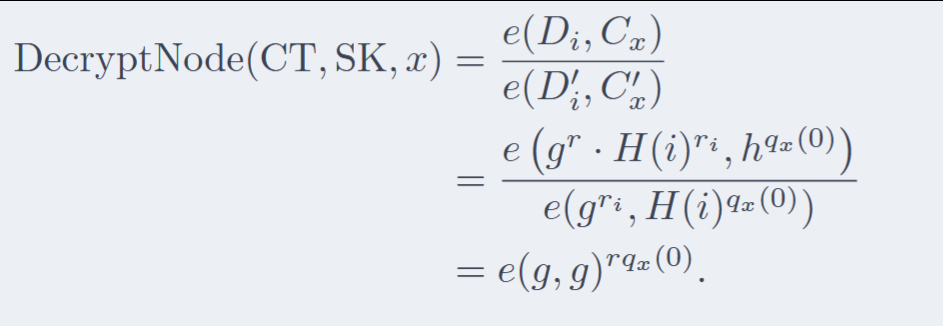
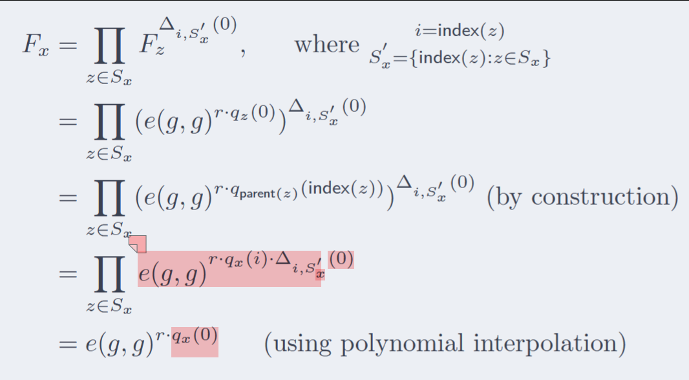

# Ciphertext-Policy Attribute-Based Encryption

这里我们开始看 KP-ABE 中提到的 CP-ABE

其实 CP-ABE 更符合我们对加密的直觉

应该是加密者指定谁可以解密，也就是具有某些属性的人可以解密

KP-ABE：加密者决定数据具有什么属性，密钥颁发机构决定什么样的属性组合可以被访问

CP-ABE：密钥颁发机构决定用户具有什么属性，加密者决定具有什么属性的用户可以访问数据

# Abstract

ABE 提出来就是为了解决分布式系统中一个用户只可以访问自己授权的数据

使用ABE系统，即使你的数据存储在不受信的服务中，依旧可以保持安全

即使有多个用户共谋联合自己的私钥，打算攻破未授权信息，在这里也是不可行的

# 1 Introduction

论文中举例了一个FBI系统，对访问人群的加密和授权

这里我们跳过直接看他要说什么

在 ABE 之前的机密数据存储中，我们为了保证数据的保密，只能以加密形式存储数据，并且要求存储地方是安全的

这种方法可以解决数据安全和授权访问的问题（把解密私钥给他）

但是不够灵活应对更复杂的访问控制，所以我们提出了ABE

## Our contribution

本论文提出的是 CP-ABE，即基于密文策略的属性基加密

用户的私钥会和任意数量的属性联系起来

当加密者通过 CP-ABE 加密一个消息的时候，会基于属性构建出访问权限结构

一个用户只有满足了这个访问权限结构才可以解密我们的消息

在数学层面，我们使用的是类似 KP-ABE 的访问树结构，也就是基于门限值的树：

- 叶子节点描述属性
- 中间节点描述门限值
- $t$-of-$n$ 门限：$t$ 是门限值，$n$ 是孩子数量

直观理解：我们有一个递归函数，对节点 $x$ 检查它的孩子是否满足 $t$ 个；如果满足，节点 $x$ 通过门限这个过程不断递归到叶子，最终判断叶子属性是否满足，从而完成属性匹配

## Our techniques

虽然本文和KP-ABE离不开，但是还是有所不同

KP-ABE：加密者无法控制谁有权利解锁消息，他必须要无条件信任密钥发放机构

所以其实判断或者说识别的 是在密钥分发机构，而不是加密者

本文视角中，加密者必须主动决定谁可以解密

所以基于KP-ABE中的一些内容 无法直接迁移到本文中

在技术层面 我们必须防止多个共谋者攻击未授权信息：

也就是如果授权解密者拿到各自解密私钥，无法联合起来解密不允许查看的信息

这个是访问控制的底线，因为这个才会出现ABE内容

在KP-ABE和FIBE中，使用的是基于多项式插值法的秘密共享方案，在每个属性中增加随机密钥，保证用户都是基于自己的随机多项式得到的随机解密密钥，从而无法联合起来

在我们方案中，用户私钥和属性关联，而访问策略在密文中；所以不能直接把 KP-ABE 的插值方式照搬到私钥上，本文把多项式插值放到了密文的访问树里

所以我们使用的是新的两级随机掩码技术：基于群论中的高效双线性配对运算，那么具体内容后面会继续说明

# 2 Related Work

这里就是说明相关工作 主要说明的是 FIBE和KP-ABE

顺便梳理一下发展过程

IBE 提出了基于身份的加密，那么 FIBE 进行了扩展，让身份扩展为身份集合，并且增加了容错率，以便于生物信息识别技术

KP-ABE是在FIBE的基础上对其提出的ABE思想进行了扩展

ABE 不再需要把解密私钥直接交给每个用户，而是使用一个 MK 生成对应的用户私钥

用户可以解密数据，只要他的属性可以匹配

在FIBE的思想中，使用的门限是一个重叠值，所以无法有效的应对复杂场景

所以引出了 KP-ABE

密文和属性结合起来，用户的解密私钥和访问授权树联系起来

在KP-ABE中，把Shamir的秘密分享嵌入私钥中

## Collusion Resistance and Attribute-Based Encryption

这里会介绍一下抵抗共谋，并讨论一个并非真正 CP-ABE 的方案

一句话说明就是：用户会尝试攻击未授权信息，通过已经得到的一些授权密钥

后面还会讨论一篇并非真正 CP-ABE 的论文，它主要采用代理服务器来隐藏策略

# 3 Background

这里我们会开始定义ABE相关内容，包括访问结构，ABE架构等

## 3.1 Definitions

访问结构：

设属性域为 $U=\{P_1,P_2,\ldots,P_n\}$，其幂集为 $2^U$

访问结构 $A$ 是 $2^U$ 的一个非空子集，即 $A\subseteq 2^U$；$A$ 中的元素是“授权属性集合”

如果对于任意 $B,C$，只要 $B\in A$ 且 $B\subseteq C\subseteq U$，就有 $C\in A$，则称 $A$ 是单调的

不在 $A$ 中的集合称为未授权集合

后续我们会用访问树 $T$ 来表示访问结构 $A$

这里说明 CP-ABE 的基础构成：四个必要算法，以及一个可选的委托算法

### 1. Setup：生成公开参数和主密钥

> - **输入**：安全参数 $k$
> - **输出**：公开参数 $PK$、主密钥 $MK$

- 随机化算法

### 2. Enc：加密消息

> - **输入**：公开参数 $PK$、明文 $M$、访问结构 $A$
> - **输出**：密文 $CT$

- 加密者用访问结构 $A$ 指定“什么样的属性集合可以解密”
- 只有用户属性集合 $S$ 满足 $A$ 时，密文才能被解密

### 3. KeyGen：生成用户私钥

> - **输入**：主密钥 $MK$、用户属性集合 $S\subseteq U$
> - **输出**：解密私钥 $SK$

- 为用户属性集合 $S$ 生成私钥；$S$ 是用户实际拥有的属性集合

### 4. Dec：解密

> - **输入**：公开参数 $PK$、密文 $CT$、私钥 $SK$
> - **输出**：明文 $M$ 或 $\bot$

- 如果用户属性集合 $S$ 满足密文中的访问结构 $A$，则输出明文 $M$

### 5. Delegate：私钥委托（可选）

> - **输入**：私钥 $SK$、属性子集 $\tilde S\subseteq S$
> - **输出**：更严格的私钥 $\widetilde{SK}$

- 允许用户把自己的一部分解密权限委托给他人，但不能通过委托扩大权限

到这里，CP-ABE 的基本构建就说明清楚了下面讨论它的安全问题，可以沿用 IBE 的安全模型

### Security Model for CP-ABE

这里说明 CP-ABE 的安全游戏，设挑战访问结构为 $A^*$

- **挑战者**：运行安全游戏
- **敌手**：攻击 CP-ABE

**Setup**：挑战者运行 $Setup$，把公开参数 $PK$ 交给敌手

**P1（密钥问询）**：敌手可以查询属性集合 $S_1,\ldots,S_{q_1}$ 对应的私钥

**Challenge**：敌手提交两个等长明文 $M_0,M_1$ 和挑战访问结构 $A^*$，并要求之前查询过的所有 $S_i$ 都不满足 $A^*$；挑战者随机选择 $b\in\{0,1\}$，用 $A^*$ 加密 $M_b$，返回密文

**P2**：敌手继续查询私钥，仍然要求 $S_i$ 不满足 $A^*$

**Guess**：敌手输出猜测 $b'$

## 3.2 Bilinear Maps

和以前的内容一样 说明一下 双线性配对，主要使用到了 非退化和双线性思想

# 4 Our Construction

这里就开始对上面的CP-ABE架构进行具体数学描述了，我们还会说明这个方案的正确性，在开始前我们还需要对一些内容进行描述

## 4.1 Access Tree

访问结构 $A$ 可以用一棵访问树 $T$ 来表示；树本身不是 $A$ 的子集，而是 $A$ 的一种表示

- 叶子节点对应属性
- 非叶子节点对应门限门

节点参数：

- $num_x$：节点 $x$ 的孩子数量
- $k_x$：节点 $x$ 的门限值，满足 $1\le k_x\le num_x$；当通过的孩子数至少为 $k_x$ 时，节点 $x$ 输出 1
  - 如果 $k_x=1$，就是 OR 门：只要有一个孩子通过即可
  - 如果 $k_x=num_x$，就是 AND 门：所有孩子都必须通过

树上还定义以下函数：

- $parent(x)$：节点 $x$ 的父亲节点
- $att(x)$：仅对叶子节点有效，返回叶子 $x$ 对应的属性字符串
- $index(x)$：返回节点 $x$ 的唯一编号；同一父节点下的孩子编号互不相同

### Satisfying an Access Tree

定义一个递归函数 $T_x(\gamma)$，用来判断属性集合 $\gamma$ 是否满足以 $x$ 为根的子树

- $T_x(\gamma)=1$：$\gamma$ 满足以 $x$ 为根的子树
- $T_x(\gamma)=0$：$\gamma$ 不满足

递归过程：

- 如果 $x$ 是叶子节点：当且仅当 $att(x)\in\gamma$ 时返回 1，否则返回 0
- 如果 $x$ 是非叶子节点：统计通过门限的孩子数量；如果至少达到 $k_x$，返回 1，否则返回 0
- 这个过程一直递归到根节点，根节点的返回值就是整个访问树的结果

## 4.2 Our Construction

上面我们对访问结构都很清晰了，下面就开始说明 CP-ABE 的构建

### 基础符号

- $G_0$：双线性群，生成元为 $g$
- $e:G_0\times G_0\to G_1$：双线性映射
- 安全参数 $k$：决定群的大小
- $\Delta_{i,S}(x)$：拉格朗日系数，用于插值：
  $$\Delta_{i,S}(x)=\prod_{j\in S,\ j\ne i}\frac{x-j}{i-j}$$
- 安全哈希函数 $H:\{0,1\}^*\to G_0$

下面开始描述 CP-ABE 的具体构造

### 1. Setup：生成公开参数和主密钥

> - **输入**：安全参数 $k$
> - **输出**：公开参数 $PK$、主密钥 $MK$

- 选择双线性群 $G_0$，阶数为 $p$，生成元为 $g$
- 随机选择 $a,b\in\mathbb{Z}_p$，且 $b\ne0$（对应原文中的 $\alpha,\beta$）
- 公开参数和主密钥为：

$$PK=\left\{G_0,\ g,\ h=g^b,\ f=g^{1/b},\ e(g,g)^a\right\}$$

$$MK=\left\{b,\ g^a\right\}$$

其中 $f$ 只会在 Delegate 算法中使用

### 2. Enc：加密消息

> - **输入**：公开参数 $PK$、明文 $M$、访问树 $T$（表示访问结构 $A$）
> - **输出**：密文 $CT$

- 为树 $T$ 的每个节点构造一个随机多项式 $q_x$
- 自顶向下构造：从根节点 $R$ 开始，节点 $x$ 的多项式次数为 $d_x=k_x-1$（叶子节点 $k_x=1$）
- 根节点令 $q_R(0)=s$，其中 $s\in\mathbb{Z}_p$ 随机选择
- 其他节点令
  $$q_x(0)=q_{parent(x)}(index(x))$$
  其余系数随机选择
- 设 $Y$ 为 $T$ 的叶子节点集合，密文为：

$$CT=\left(T,\ \tilde C=M e(g,g)^{as},\ C=h^s,\ \left\{C_y=g^{q_y(0)},\ C'_y=H(att(y))^{q_y(0)}\right\}_{y\in Y}\right)$$

- 每个叶子属性 $y$ 都会产生 $C_y$ 和 $C'_y$，从而把属性嵌入密文

### 3. KeyGen：生成用户私钥

> - **输入**：主密钥 $MK$、用户属性集合 $S$
> - **输出**：解密私钥 $SK$

- 随机选择 $r\in\mathbb{Z}_p$
- 对每个 $j\in S$，随机选择 $r_j\in\mathbb{Z}_p$
- 生成私钥：

$$SK=\left(D=g^{(a+r)/b},\ \left\{D_j=g^r H(j)^{r_j},\ D'_j=g^{r_j}\right\}_{j\in S}\right)$$

- KeyGen 在 Setup 之后随时可以运行，不需要等待密文产生

### 4. Delegate：私钥委托

> - **输入**：私钥 $SK$、属性子集 $\tilde S\subseteq S$
> - **输出**：更严格的私钥 $\widetilde{SK}$

- 随机选择 $\tilde r\in\mathbb{Z}_p$
- 对每个 $k\in\tilde S$，随机选择 $\tilde r_k\in\mathbb{Z}_p$
- 生成新私钥：

$$\tilde D=D f^{\tilde r}$$

$$\tilde D_k=D_k\,g^{\tilde r}\,H(k)^{\tilde r_k},\qquad \tilde D'_k=D'_k\,g^{\tilde r_k}\quad(k\in\tilde S)$$

- 委托只能缩小权限，不能扩大权限

### 5. Dec：解密

> - **输入**：公开参数 $PK$、密文 $CT$、私钥 $SK$
> - **输出**：明文 $M$ 或 $\bot$

定义递归算法 $\mathrm{DecryptNode}(CT,SK,x)$，自下而上检查节点是否满足访问树

**叶子节点**：令 $i=att(x)$如果 $i\in S$，计算

注意：图中分子应为 $g^{q_x(0)}$，不是 $h^{q_x(0)}$；否则 $H(i)$ 项无法约掉

其中 $C_x=g^{q_x(0)}$，$C'_x=H(i)^{q_x(0)}$；结果等于

$$e(g,g)^{r q_x(0)}$$

否则返回 $\bot$

**非叶子节点**：对每个孩子 $z$ 递归调用，得到 $F_z$，然后通过拉格朗日插值恢复

也就是说，前面几步只是把 $F_z$ 展开；最后用插值法得到的是

$$F_x=e(g,g)^{r q_x(0)}$$

注意：这里恢复的是 $e(g,g)^{r q_x(0)}$，不是 $q_x(0)$ 本身

**根节点**：递归到根 $R$，得到

$$F_R=e(g,g)^{r q_R(0)}=e(g,g)^{rs}$$

**恢复明文**：从密文中取出 $\tilde C=M e(g,g)^{as}$，计算

$$\frac{\tilde C}{e(C,D)/e(g,g)^{rs}}=M$$

其中

$$\frac{e(C,D)}{e(g,g)^{rs}}=\frac{e(h^s,g^{(a+r)/b})}{e(g,g)^{rs}}=e(g,g)^{as}$$

使用双线性配对即可得到 $M$

可以发现，除了 Delegate 之外，其他部分还是很自然的

我们不需要纠结为什么这样设置，理解他的构造思路即可：

- 使用双线性配对去除随机值
- 使用访问树和 $\mathrm{DecryptNode}$ 进行属性匹配和门限判断

## 4.3 Discussion

后续内容不再展开；这里主要理解 CP-ABE 是如何实现的即可

到这里，我们就理解了 CP-ABE 的基本实现
